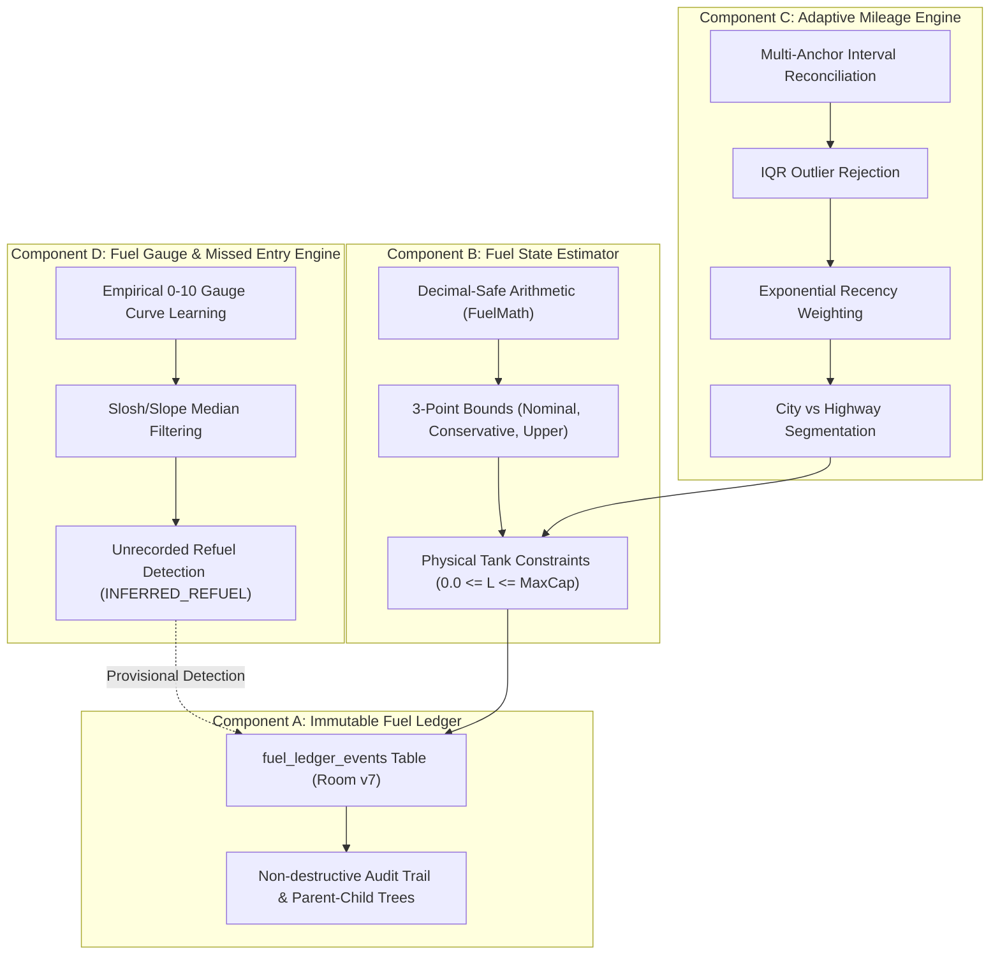

# Adaptive Fuel Intelligence Engine — Design Document

## 1. System Overview
The **Adaptive Fuel Intelligence Engine** replaces simplistic, naive fuel subtraction with a robust, enterprise-grade multi-engine telemetry fusion architecture specifically designed for Android-based automotive infotainment systems (1280×800 landscape).

The engine operates under the physical realities of automotive fuel tanks:
- Tank geometric non-linearity (float sender resistance curves).
- Pitch/roll fuel slosh caused by vehicle tilt and acceleration.
- Frequent partial refills without full tank top-ups.
- Missed or forgotten user log entries.
- Unavoidable sensor latency and GPS tracking drift.

---

## 2. Core Components

### Component A: Immutable Fuel Ledger
- **Storage**: Room schema v7 (`fuel_ledger_events`) + continuous JSON mirror to persistent storage.
- **Immutability**: Historical records are never destructively overwritten (`UPDATE`/`DELETE`).
- **Correction Pattern**: User edits or deletions create new child events (`FUEL_CORRECTION`, `MANUAL_FUEL_ADJUSTMENT`) linking to `parentId`.
- **Supported Event Types**:
  1. `INITIAL_FUEL_BASELINE`
  2. `REFUEL`
  3. `TRIP_FUEL_CONSUMPTION`
  4. `ODOMETER_UPDATE`
  5. `FUEL_GAUGE_UPDATE`
  6. `INFERRED_REFUEL`
  7. `FUEL_CORRECTION`
  8. `MILEAGE_ESTIMATE_UPDATE`
  9. `MANUAL_FUEL_ADJUSTMENT`

### Component B: Fuel State Estimator
- **Precision**: Arithmetic scaled using `BigDecimal` with half-up rounding (`FuelMath.kt`).
- **Bounds**:
  - `Nominal`: Expected central estimate.
  - `Conservative`: Buffer for early low-fuel warning.
  - `Upper`: Maximum plausible volume.
- **Physical Invariants**:
  - Never drops below $0.0\text{ L}$ (hard floor).
  - Additions exceeding OEM capacity safely expand up to $1.35\times$ design capacity for filler neck fuel.

### Component C: Adaptive Statistical Mileage Engine
- **Partial Refill Formula**:
  $$\text{Fuel Consumed} = \text{Starting Fuel} + \sum \text{Added Fuel} - \text{Ending Fuel}$$
  $$\text{Mileage (km/L)} = \frac{\Delta\text{Odometer}}{\text{Fuel Consumed}}$$
  Eliminates the bug where added liters was assumed to equal burned liters.
- **IQR Outlier Rejection**: Rejects erroneous inputs where calculated mileage falls outside $[Q_1 - 1.5\text{IQR}, Q_3 + 1.5\text{IQR}]$.
- **Recency Weighting**: Applies exponential decay weights ($e^{\lambda t}$) so recent driving intervals dominate older records while maintaining stability.
- **Segmentation**: Segregates Highway ($\ge 60\text{ km/h}$) from City driving telemetry.

### Component D: Fuel Gauge Calibration & Missed Entry Intelligence
- **Curve Learning**: Maps 10-bar LED instrument clusters non-linearly, enforcing strict monotonicity ($B_{k+1} \ge B_k$).
- **Slosh Filter**: Rolling median filter across 60-second observation windows to reject momentary accelerations or slope readings.
- **Missed Entry Detection**:
  When observed gauge reading implies an unrecorded increase $\ge 4.0\text{ L}$ compared to physical state prediction, generates `INFERRED_REFUEL` with `PROVISIONAL` confidence and plausible bounds $[V_{min}, V_{max}]$.
