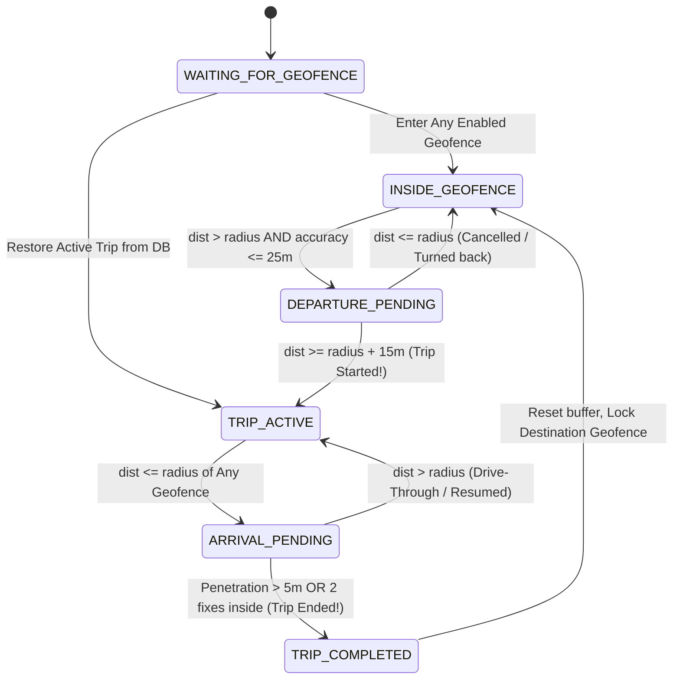

# Geofence-Based Automatic Trip Lifecycle System Architecture & Design Specification

**Document Version:** 1.17.0  
**Target Platform:** Android Automotive / Head Unit / Infotainment (1280x800 Landscape)  
**Package:** `com.antigravity.drivingreport`  
**Classification:** Core System Architecture Specification

---

## 1. Executive Overview

This document specifies the architecture and state machine of the **Pure Geofence-Based Automatic Trip Lifecycle System**. 

The fundamental architectural principle is the **strict separation of concerns** between:
1. **Trip Lifecycle Boundaries (Start & End):** Controlled exclusively by user-configured spatial geofence boundaries.
2. **GPS Distance & Telemetry Tracking:** Operates independently, recording continuous GPS points, speeds, accelerations, stationary durations, and fuel consumption without interruption.

```
+-----------------------------------------------------------------------------------+
|                           GEOFENCE TRIP LIFECYCLE                                |
|                                                                                   |
|  [INSIDE GEOFENCE]  --- (Exit Boundary + Anti-Jitter) --->  [TRIP ACTIVE]        |
|          ^                                                        |               |
|          |                                                        |               |
|          +------------ (Entry Boundary Confirmed) <---------------+               |
+-----------------------------------------------------------------------------------+
                                       |
                   Telemetry and Points passed independently
                                       v
+-----------------------------------------------------------------------------------+
|                        INDEPENDENT DISTANCE & TELEMETRY ENGINE                    |
|                                                                                   |
|  * Distance Accumulation          * Accelerations & Longitudinal G-Forces         |
|  * Real-Time & Average Speed      * Fuel Consumption & Cost Tracking             |
|  * Stationary Periods (Traffic)   * Route Points & Trail Map Drawing             |
+-----------------------------------------------------------------------------------+
```

---

## 2. Core Lifecycle Rules

### 2.1 Trip Start (Geofence Departure)
- **Trigger:** Vehicle exits beyond ANY enabled geofence boundary ($d > \text{radius} + \text{hysteresis}$).
- **Default Radius:** 200 meters (configurable between 50m and 2,000m).
- **Anti-Jitter Debounce:**
  - `MAX_ACCURACY_THRESHOLD_METERS = 25.0f`: GPS fixes with accuracy $> 25\text{m}$ are rejected for boundary transition checks to avoid false triggers caused by satellite multipath or GPS drift.
  - `DEBOUNCE_HYSTERESIS_METERS = 15.0f`: The vehicle must travel at least 15m beyond the radius boundary or maintain outward speed $\ge 3.0\text{ km/h}$ across 2 consecutive fixes.
  - If the vehicle returns inside the radius while departure is pending, departure is cancelled immediately.
- **Pre-Trip Buffer Attachment:** A 5-minute rolling FIFO buffer collected while inside the geofence is evaluated. Points starting from the vehicle's initial departure movement are prepended to the trip trail, capturing the first ~200 meters of travel within the origin geofence.
- **Timestamp & Timer:** The trip timer begins ticking from the confirmed departure event timestamp.
- **Internal Movement:** Vehicle movement inside the geofence boundary **never** initiates a trip.

### 2.2 Trip End (Geofence Arrival)
- **Trigger:** Vehicle enters within ANY enabled geofence boundary ($d \le \text{radius}$).
- **Immediate Boundary Confirmation:**
  - With accuracy $\le 25\text{m}$, arrival is confirmed when the vehicle penetrates $> 5\text{m}$ inside the boundary or records 2 consecutive fixes within the zone.
  - **Zero Arbitrary Delay:** The system does NOT require arbitrary idle wait times (no 5-minute or 20-second dwell timeouts) or a minimum distance.
- **Timer Stoppage:** The trip timer stops at the exact confirmed arrival timestamp.
- **Visual Alert:** Triggers a 3-second red pulsing completion banner, transitioning to a persistent RED state.
- **Outside Standstills:** Stopping outside a geofence (red traffic signals, drive-throughs, highway rest stops, roadside parking) accumulates `stationaryDurationMs` but **NEVER** terminates the trip.

---

## 3. Finite State Machine (FSM)



### State Descriptions
1. **`WAITING_FOR_GEOFENCE`**: Initial state when the app launches and the vehicle is outside all configured geofences without an existing active trip. Awaits entry into an enabled geofence.
2. **`INSIDE_GEOFENCE`**: Vehicle is located within an enabled geofence boundary. Maintains rolling 5-minute pre-trip buffer.
3. **`DEPARTURE_PENDING`**: Vehicle crossed boundary outward. Evaluates debounce hysteresis.
4. **`TRIP_ACTIVE`**: Ongoing journey. Pure geofence tracking mode is active; GPS points, distance, and speeds are continuously updated.
5. **`ARRIVAL_PENDING`**: Vehicle entered edge of destination geofence. Confirms genuine entry versus boundary grazing.
6. **`TRIP_COMPLETED`**: Finalizes trip summary in SQLite, triggers persistent red status, and locks destination geofence.

---

## 4. Multi-Geofence Management & Edge Cases

| Scenario | System Handling |
| :--- | :--- |
| **Direct Travel Between Geofences** | Exiting Geofence A (Home) starts Trip 1. Entering Geofence B (Office) immediately concludes Trip 1. When the vehicle later leaves Geofence B, Trip 2 starts. |
| **Overlapping Geofences** | `findGeofenceContaining` detects all enabled geofences. As long as the vehicle is within at least one enabled boundary, it remains in `INSIDE_GEOFENCE`; a trip starts only after leaving all overlapping zones. |
| **App Process Kill / Reboot** | On startup, `DrivingTrackingService` queries `tripDao.getActiveTrip()`. If an active trip exists, `restoreActiveTrip` restores state to `TRIP_ACTIVE`, preserving start time, accumulated distance, and duration. |
| **Vehicle Ignition Off Outside** | Engine shutdown outside a geofence transitions vehicle state to `ENGINE_OFF` and accumulates stationary duration, but leaves the trip active in Room DB for multi-day continuity. |
| **GPS Signal Interruption** | Temporary satellite outage does not end the trip; once GPS fix is reacquired, distance calculation resumes geodesically between valid fixes. |
| **Geofence Modified While Active** | Geofence updates and radius modifications take effect dynamically in memory via Room `Flow` observation. |

---

## 5. Diagnostic Logging Architecture

All transitions, evaluations, and rejections are recorded via `GeofenceDiagnostics`:
- `GeofenceDiagnosticEvent`:
  - `timestamp`: Epoch millisecond of event.
  - `geofenceId` & `geofenceName`: Target geofence identity.
  - `radiusMeters` & `distanceMeters`: Boundary measurements.
  - `locationAccuracy`: GPS fix accuracy in meters.
  - `previousState` & `currentState`: State machine transition.
  - `eventType`: `TRIP_START_CONFIRMED`, `TRIP_END_CONFIRMED`, `DEPARTURE_PENDING`, `DEPARTURE_CANCELLED`, `ARRIVAL_PENDING`, `DEPARTURE_REJECTED`.
  - `reason`: Structured human-readable rationale.
